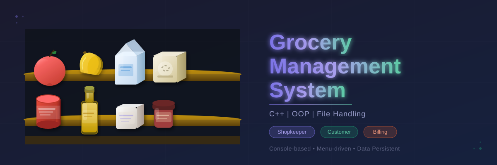
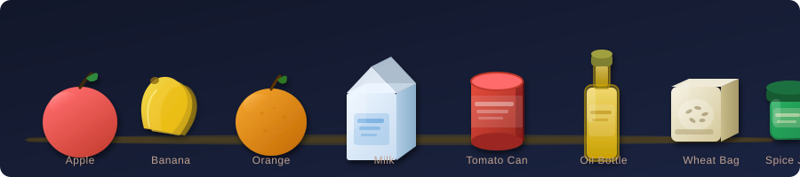

<p align="center">
  
</p>

<p align="center">
  
  
  
  
  
</p>

---

## What is this?

A **console-based Grocery Management System** built in **C++** using Object-Oriented Programming and File Handling. This project simulates a real grocery shop where a shopkeeper can manage inventory, customers can register, and bills can be generated — all data saved permanently using `.txt` files.

> Built as a college project for **MCA — Department of Computer Applications, LPU**  
> Demonstrates: `Classes & Objects` · `fstream` · `Menu-driven programming`

---

## Items in the Store

<p align="center">
  
</p>

---

## Features

### 🛒 Shopkeeper Module
| Feature | Description |
|---------|-------------|
| Add Item | Add new grocery item with all details |
| View All Items | Display full inventory in table format |
| Search by ID | Find any item instantly using its ID |
| Update Item | Modify existing item's details |
| Delete Item | Remove an item record permanently |

### 👤 Customer Module
| Feature | Description |
|---------|-------------|
| Add Customer | Register a new customer with contact info |
| View All Customers | Display complete customer list |

### 🧾 Billing Module
| Feature | Description |
|---------|-------------|
| Create Bill | Generate bill with customer + item details |
| Auto Stock Reduce | Item quantity automatically decreases after purchase |
| Save Bill | Bills permanently saved in `bills.txt` |
| View All Bills | See history of all generated bills |

---

## Project Structure

```
GroceryManagementSystem/
│
├── GroceryManagementSystem.cpp   ← Main source file (all code here)
│
├── items.txt                     ← Auto-created: stores grocery items
├── customers.txt                 ← Auto-created: stores customer records
└── bills.txt                     ← Auto-created: stores generated bills
```

> **Note:** The three `.txt` files are created automatically when you run the program for the first time. You don't need to create them manually.

---

## Item Details Stored

```
Item ID | Item Name | Category | Quantity | Price | Mfg Date | Expiry Date
```

**Example entry in `items.txt`:**
```
101|Sugar|Grocery|100|45.00|01/01/2025|01/01/2026
102|Rice|Staples|50|60.00|15/06/2024|15/06/2026
103|Milk|Dairy|30|28.00|28/06/2026|30/06/2026
```

---

## OOP Concepts Used

```cpp
// Three classes — each handles its own data and operations

class Item {
    // 7 data members: itemID, itemName, category, quantity,
    //                 price, mfgDate, expDate
    // 5 functions: addItem(), viewAllItems(), searchItem(),
    //              updateItem(), deleteItem()
};

class Customer {
    // 4 data members: custID, custName, mobile, address
    // 3 functions: addCustomer(), viewCustomers(),
    //              getCustomerName()  ← helper for billing
};

class Bill {
    // 2 functions: createBill(), viewBills()
    // Internally uses Customer + Item data
};
```

**Key OOP Concept — Encapsulation:**  
Each class bundles its related data and functions together. Outside code accesses everything through class methods only.

---

## File Handling Explained

| Concept | Where Used |
|---------|------------|
| `ofstream (ios::app)` | Adding new items/customers — appends without erasing old data |
| `ifstream` | Reading records for view and search operations |
| **Temp File Trick** | Update and Delete — reads original → writes temp → replaces original |
| `remove()` + `rename()` | Used to swap temp file with original after update/delete |

**Temp File Trick (used for update & delete):**
```cpp
// Step 1: Read original, write to temp (skip/modify target line)
ifstream file("items.txt");
ofstream temp("temp_items.txt");

// Step 2: Replace original with updated temp
remove("items.txt");
rename("temp_items.txt", "items.txt");
```

---

## Menu Structure

```
============================================
     WELCOME TO GROCERY MANAGEMENT SYSTEM
============================================

======= MAIN MENU =======
1. Shopkeeper Section
2. Customer Section
3. Billing Section
4. Exit
```

---

## Sample Output

**Adding an item:**
```
--- Add New Item ---
Enter Item ID     : 101
Enter Item Name   : Sugar
Enter Category    : Grocery
Enter Quantity    : 100
Enter Price (Rs.) : 45
Mfg Date (DD/MM/YYYY) : 01/01/2025
Exp Date (DD/MM/YYYY) : 01/01/2026

[SUCCESS] Item added successfully!
```

**Generated bill:**
```
--------------------------------------------
       GROCERY MANAGEMENT SYSTEM
              CUSTOMER BILL
--------------------------------------------
Date         : 28/06/2026
Customer ID  : 1
Customer Name: Rahul Sharma
--------------------------------------------
Item ID      : 101
Item Name    : Sugar
Category     : Grocery
Price/Unit   : Rs.45
Quantity     : 2
--------------------------------------------
TOTAL AMOUNT : Rs.90
============================================
[SUCCESS] Bill saved to bills.txt!
```

---

## How to Run

### Using CodeBlocks (Recommended)

1. Open **CodeBlocks**
2. Go to `File → New → Empty File`
3. Paste the code from `GroceryManagementSystem.cpp`
4. Save as `GroceryManagementSystem.cpp`
5. Press **F9** (Build & Run)

> If you get a `stoi` / `stof` error:  
> Go to `Settings → Compiler → Compiler Flags` → tick **"Have g++ follow the C++11 ISO"**

### Using Terminal / Command Line

```bash
# Compile
g++ -std=c++11 GroceryManagementSystem.cpp -o grocery

# Run (Linux / Mac)
./grocery

# Run (Windows)
grocery.exe
```

---

## Tech Stack

```
Language    →  C++
Standard    →  C++11
Compiler    →  GCC (g++)
IDE         →  CodeBlocks (recommended)
Storage     →  Plain text files (.txt)
Concepts    →  OOP (Classes, Objects, Encapsulation)
             →  File Handling (fstream, ifstream, ofstream)
             →  Menu-driven programming (do-while loops)
```

---

## Quick Viva Points

| Question | Quick Answer |
|----------|-------------|
| How many classes? | 3 — `Item`, `Customer`, `Bill` |
| OOP concept used? | Encapsulation — data + functions in one class |
| Why `ios::app`? | To add new records without deleting old ones |
| Why pipe `\|` separator? | Item names may have commas; `\|` is safer |
| How does delete work? | Temp file trick — copy all except target line |
| How does billing reduce stock? | `createBill()` updates quantity via temp file trick |
| What is `initFiles()`? | Creates the 3 `.txt` files automatically on first run |
| What does `getCustomerName()` do? | Helper — finds customer name from ID for billing |

---

## Author

**Ayush Raj**  
MCA Student — Department of Computer Applications  
Lovely Professional University (LPU)

---

<p align="center">Made with C++ | OOP | File Handling</p>
